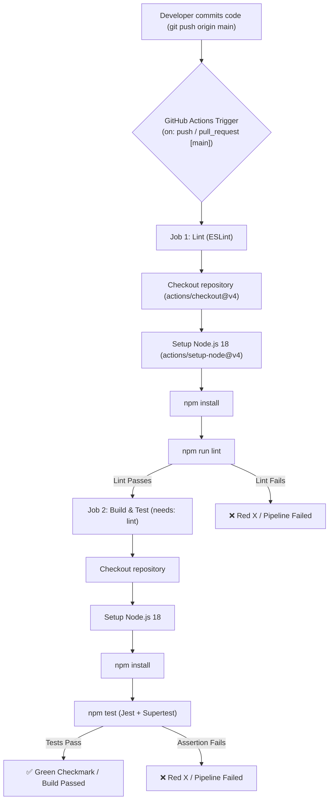

# Practical 12: CI/CD Pipeline with GitHub Actions

[](https://github.com/Ary3126/Advance-web-technology/actions/workflows/ci.yml)

## Academic & Course Information
- **Course**: Advanced Web Development Frameworks (ITUE301)
- **Module**: Practical 12
- **Course Outcome (CO)**: CO5 &mdash; Automate testing, build, and deployment pipelines using modern continuous integration tools.
- **Program Outcomes (PO)**: PO3 (Design/development of solutions), PO5 (Modern tool usage).
- **Author**: Ary Patel
- **Repository**: [Advance-web-technology](https://github.com/Ary3126/Advance-web-technology)

---

## 🎯 Objective
To automate testing and quality assurance of the Task Management application using a Continuous Integration (CI) pipeline implemented with **GitHub Actions**, **Jest**, and **Supertest**.

---

## 📋 Prerequisites
1. **Practical 11 Completed**: Containerized full-stack Task Management application.
2. **GitHub Repository**: Remote repository configured at `https://github.com/Ary3126/Advance-web-technology.git`.
3. **YAML Syntax**: Understanding of keys, arrays, indentation, triggers, jobs, and steps.
4. **Node.js Environment**: Node v18+ with `npm`.

---

## 🏗️ Architecture & Pipeline Workflow

### CI/CD Workflow Flowchart



### Pipeline ASCII Sequence
```text
git push origin main
       |
       v
GitHub Actions Trigger (on: push, branches: [main])
       |
       +---> Job 1: lint (ESLint Quality Gate)
       |        ├── Checkout code
       |        ├── Setup Node.js 18
       |        ├── npm install
       |        └── npm run lint
       |
       v (needs: lint)
Job 2: build-and-test (Automated Regression Suite)
       ├── Checkout code
       ├── Setup Node.js 18
       ├── npm install
       ├── Run tests: npm test (Jest + Supertest)
       └── Report status
       |
       +---> Pass: Green Checkmark (status: 200 OK)
       +---> Fail: Red X (assertion error / deliberate failure)
```

---

## 🔍 Key Questions & Technical Analysis

### 1. What is the difference between Continuous Integration and Continuous Deployment, and which one does this practical actually demonstrate?
- **Continuous Integration (CI)**:
  The development practice of frequently merging code changes into a shared repository (often multiple times per day). Each integration is automatically verified by automated builds and automated tests (e.g., unit, integration, and linting checks). CI ensures that software regressions and incompatibilities are detected immediately upon code commit.
- **Continuous Deployment (CD)**:
  An extension of Continuous Integration where every change that successfully passes all stages of the production pipeline (tests, security scans, container builds) is automatically deployed directly to the production environment without human intervention. (Alternatively, *Continuous Delivery* keeps the build deployable but requires manual approval before production deployment).
- **Practical Application**:
  This practical specifically demonstrates **Continuous Integration (CI)**. It automatically validates code quality using ESLint and runs Jest/Supertest automated tests against API endpoints on every push/pull request to `main`. It reports a binary pass/fail verification status (green checkmark or red X) without deploying containers to live hosting infrastructure.

---

### 2. Why does running tests automatically on every push catch problems earlier than testing manually before a release?
1. **Immediate Feedback Loop**:
   Developers receive test results within minutes of pushing code. If a change breaks an existing API contract, the author knows while the mental context of their code changes is still fresh.
2. **Minimal Blast Radius & Easy Attribution**:
   Push-triggered testing isolates bugs to the exact git commit that introduced them. Instead of reviewing hundreds of changes before a monthly release, developers only inspect the few files modified in the offending commit.
3. **Prevention of Compounding Defects**:
   A single silent bug left undetected often cascades into secondary errors when other team members build on top of flawed code. CI stops defect propagation at the entry point.
4. **Consistency & Zero Human Error**:
   Manual pre-release testing frequently skips edge cases or depends on developer fatigue. CI executes the identical, deterministic test suite every single time across clean Ubuntu runners.

---

### 3. What would happen to the pipeline if the test file path were incorrect &mdash; would the workflow fail at the same step as a genuine test failure?
- **Workflow Step Comparison**:
  **Yes**, the workflow would fail at the **exact same step** (`npm test`), because any non-zero exit code emitted by the process terminates the runner step immediately.
- **Log Diagnosis & Root Cause Difference**:
  - **Genuine Test Failure**:
    The test runner successfully discovers the test suite, executes HTTP requests against the application, and fails on an **assertion** (`expect(res.statusCode).toBe(200)`). The log clearly highlights:
    ```text
    Expected: 200
    Received: 500
    ```
  - **Incorrect File Path Error**:
    The test runner terminates during **discovery/initialization** before executing any assertions. Jest outputs:
    ```text
    No tests found, exiting with code 1
    Pattern: nonexistent/path/test.js - 0 matches
    ```
  Although both cause a Red X on GitHub Actions, the log diagnosis differs: one is an infrastructure/path error, while the other is a genuine functional regression.

---

## 💡 Supplementary Problems Solutions

### Supplementary Problem 1: Second Job Running ESLint Linter Before Test Job
Implemented in [`.github/workflows/ci.yml`](file:///D:/advance%20web%20technology/.github/workflows/ci.yml):
```yaml
jobs:
  lint:
    name: Lint Code (ESLint)
    runs-on: ubuntu-latest
    steps:
      - uses: actions/checkout@v4
      - uses: actions/setup-node@v4
        with:
          node-version: 18
      - run: npm install
      - run: npm run lint

  build-and-test:
    name: Build & Automated Tests
    runs-on: ubuntu-latest
    needs: [lint]  # Enforces that lint MUST pass before tests run
    steps:
      - uses: actions/checkout@v4
      - uses: actions/setup-node@v4
        with:
          node-version: 18
      - run: npm install
      - run: npm test
```

### Supplementary Problem 2: Configure Workflow to Run Only on Pull Requests
To restrict the workflow exclusively to Pull Requests targeting `main` (and disable direct push triggers), update the `on:` block as follows:
```yaml
# Run ONLY on pull requests targeting main branch
on:
  pull_request:
    branches: [main]
```

### Supplementary Problem 3: Pipeline Status Badge
The live status badge is embedded at the top of this documentation and the project root `README.md`:
```markdown
[](https://github.com/Ary3126/Advance-web-technology/actions/workflows/ci.yml)
```

---

## 🛠️ Step-by-Step Practical Implementation

### Step 1: Install Testing Libraries
Install `jest` and `supertest` along with `eslint`:
```powershell
npm install --save-dev jest supertest eslint
```

### Step 2: Write Automated API Tests (`tests/tasks.test.js`)
```javascript
const request = require('supertest');
const app = require('../server');

describe('Task Management API - CI/CD Automated Test Suite', () => {
  // Required Endpoint Test
  test('GET /tasks returns 200', async () => {
    const res = await request(app).get('/tasks');
    expect(res.statusCode).toBe(200);
    expect(res.body).toHaveProperty('success', true);
    expect(Array.isArray(res.body.tasks)).toBe(true);
  });

  // Supplementary Endpoint Test
  test('GET /api/health returns 200 and healthy status', async () => {
    const res = await request(app).get('/api/health');
    expect(res.statusCode).toBe(200);
    expect(res.body).toHaveProperty('status', 'healthy');
  });

  // Root Status Test
  test('GET / returns 200 with practical details', async () => {
    const res = await request(app).get('/');
    expect(res.statusCode).toBe(200);
    expect(res.body.practical).toContain('Practical 12');
  });

  // 404 Route Test
  test('GET /api/nonexistent returns 404 status code', async () => {
    const res = await request(app).get('/api/nonexistent');
    expect(res.statusCode).toBe(404);
  });
});
```

### Step 3: Create GitHub Actions Workflow (`.github/workflows/ci.yml`)
The workflow file is committed at `.github/workflows/ci.yml` with triggers on `push` and `pull_request` targeting `main`, executing Node.js 18, `npm install`, and `npm test`.

---

## 🧪 Demonstration: Broken Test vs. Fixed Test

### 1. Deliberately Broken Test (Failing Pipeline Demonstration)
When modifying the expectation to an impossible status:
```javascript
test('DELIBERATELY BROKEN: Expects status 500 but GET /tasks returns 200', async () => {
  const res = await request(app).get('/tasks');
  expect(res.statusCode).toBe(500); // Fails because API returns 200
});
```

**Terminal / CI Failure Log:**
```text
FAIL PRA-12/tests/broken.test.sample.js
  [DEMO ONLY] Deliberately Broken Test Case
    × DELIBERATELY BROKEN: Expects status 500 but GET /tasks returns 200 (23 ms)

  ● [DEMO ONLY] Deliberately Broken Test Case › DELIBERATELY BROKEN: Expects status 500 but GET /tasks returns 200

    expect(received).toBe(expected) // Object.is equality

    Expected: 500
    Received: 200

      35 |     // Expected: 500
      36 |     // Received: 200
    > 37 |     expect(res.statusCode).toBe(500);
         |                            ^
      38 |   });
      39 | });

Test Suites: 1 failed, 1 total
Tests:       1 failed, 1 total
Snapshots:   0 total
Time:        1.764 s
Command exited with code 1.
```
> **GitHub Result**: **Red X (Process completed with exit code 1)** under GitHub Actions tab.

---

### 2. Fixed Test (Passing Pipeline Demonstration)
Correcting the assertion back to the expected `200`:
```javascript
test('GET /tasks returns 200', async () => {
  const res = await request(app).get('/tasks');
  expect(res.statusCode).toBe(200);
});
```

**Terminal / CI Success Log:**
```text
PASS PRA-12/tests/tasks.test.js
  Task Management API - CI/CD Automated Test Suite
    √ GET /tasks returns 200 (31 ms)
    √ GET /api/health returns 200 and healthy status (8 ms)
    √ GET / returns 200 with practical details (6 ms)
    √ GET /api/nonexistent returns 404 status code (9 ms)

Test Suites: 1 passed, 1 total
Tests:       4 passed, 4 total
Snapshots:   0 total
Time:        1.409 s
Ran all test suites matching /PRA-12\tests\tasks.test.js/i.
Command exited with code 0.
```
> **GitHub Result**: **Green Checkmark (All checks have passed)** under GitHub Actions tab.

---

## 📊 File Directory Structure

```text
advance web technology/
├── .github/
│   └── workflows/
│       ├── ci.yml                 <-- Primary CI Pipeline (Lint + Test jobs)
│       └── TEMPLATE_ci.yml
├── PRA-12/
│   ├── middleware/
│   │   ├── auth.js                <-- JWT authentication middleware
│   │   └── validate.js            <-- Payload validation middleware
│   ├── models/
│   │   ├── Task.js                <-- Mongoose Task schema
│   │   └── User.js                <-- Mongoose User schema with password hashing
│   ├── tests/
│   │   ├── tasks.test.js          <-- Jest + Supertest test suite (4 passing tests)
│   │   └── broken.test.sample.js  <-- Deliberate test failure demonstration
│   ├── cache.js                   <-- In-memory cache helper
│   ├── events.js                  <-- Task EventEmitter notifications
│   ├── listeners.js               <-- Event listeners
│   ├── server.js                  <-- Express Task API with /tasks & /api/health
│   ├── package.json               <-- Project manifest & scripts
│   ├── eslint.config.js           <-- ESLint 9 configuration
│   ├── .env.example               <-- Environment configuration template
│   ├── .env                       <-- Local environment file
│   └── README.md                  <-- Practical 12 Comprehensive Report
├── eslint.config.js               <-- Root ESLint config
├── package.json                   <-- Root project scripts (test, lint, dev)
└── README.md                      <-- Root repository documentation with CI badge
```

---

## 🚀 How to Run Locally

### Run Tests
```powershell
# Run from repository root
npm test

# Or run directly inside PRA-12
cd PRA-12
npm test
```

### Run Linter
```powershell
# From root
npm run lint

# Or inside PRA-12
cd PRA-12
npm run lint
```

### Run Deliberately Broken Test (Demonstration)
```powershell
npm run test:broken
```

### Start Application Server
```powershell
npm run dev:pra12
# Server runs on http://localhost:5000
```
