# Practical 13: AI API Integration into a Web Application

## Academic & Course Information
- **Course**: Advanced Web Development Frameworks (ITUE301)
- **Module**: Practical 13
- **Course Outcome (CO)**: CO6 &mdash; Integrate external AI cloud services into modern web architectures and understand responsible AI engineering.
- **Program Outcomes (PO)**: PO3 (Design/development of solutions), PO5 (Modern tool usage), PO12 (Life-long learning & ethics).
- **Author**: Ary Patel
- **Repository**: [Advance-web-technology](https://github.com/Ary3126/Advance-web-technology)

---

## 🎯 Objective
To integrate an external AI service (OpenAI API / Google Gemini API) securely into an existing full-stack Task Management application, implement **graceful degradation** so that external outages never crash the application, and apply **Responsible AI** principles (human-in-the-loop review, rate limiting, and privacy safeguards).

---

## 📋 Prerequisites
1. **Practical 6 / 11 Full-Stack Application**: Existing Express backend and React SPA.
2. **AI Provider API Key**: OpenAI API Key (`OPENAI_API_KEY`) or Google Gemini API Key (`GEMINI_API_KEY`) stored in `.env`.
3. **Node.js Environment**: Node v18+ with `npm`.
4. **Postman**: For backend endpoint testing.

---

## 🏗️ Architecture & Integration Workflow

```mermaid
sequenceDiagram
    autonumber
    actor User as User (Browser)
    participant React as React Frontend (:5174)
    participant Express as Express Backend (:5000)
    participant RateLimit as Rate Limiter Middleware
    participant AI as OpenAI / Gemini API

    User->>React: Enters Task Title ("Implement OAuth2")
    User->>React: Clicks "✨ Generate AI Description"
    React->>React: Sets loading state (disabled button, spinner)
    React->>Express: POST /api/ai/generate-description { title }
    Express->>RateLimit: Check IP request count (< 5 req/min)
    alt Rate limit exceeded
        RateLimit-->>React: 429 Too Many Requests (Retry after X seconds)
    else Rate limit OK
        Express->>AI: Chat Completion Request (API Key in .env)
        alt Third-Party API Success
            AI-->>Express: Response with generated description
            Express-->>React: 200 OK { description, suggestedPriority, source, fallback: false }
        else Third-Party API Failure / Timeout / Invalid Key
            AI-->>Express: Error (401, 429, Timeout, Network Failure)
            Express->>Express: Catch error -> invoke Heuristic Fallback Engine
            Express-->>React: 200 OK { description: fallbackText, fallback: true }
        end
    end
    React->>React: Populates editable <textarea> & selects priority
    React->>User: Displays editable suggestion + Responsible AI Disclaimer
    User->>React: Reviews/edits suggestion -> Clicks "Add Task"
    React->>Express: POST /api/tasks (Saves confirmed task)
```



---

## 🔍 Key Questions & Technical Analysis

### 1. Why must the AI API key be called from the backend rather than directly from the React frontend?
* **Exposure in Client Bundles**: Any code executed in the browser (HTML, JavaScript, React components) is publicly accessible to the end user. Environment variables with prefixes like `VITE_` or `REACT_APP_` are statically replaced and embedded in plain text inside JavaScript bundles.
* **Network Tab Inspection**: If the frontend directly made an HTTP request to `api.openai.com`, the API key would be visible in the browser's DevTools Network tab (`Authorization: Bearer sk-...`).
* **Financial & Abuse Risks**: An exposed API key can be scraped by automated bots within seconds of being pushed or published, leading to malicious credit consumption, denial-of-service, or account revocation.
* **Architectural Decoupling**: Routing through the Express backend enables request sanitization, authentication verification, rate limiting, and model abstraction without client modifications.

---

### 2. What does "Graceful Degradation" mean in this context, and why does it matter for a feature that depends on a third-party service outside your control?
* **Definition**: Graceful degradation is a software design pattern where a system continues to operate in a reduced or fallback capacity when one of its non-critical components fails, rather than crashing completely.
* **Why it matters for AI dependencies**:
  1. Third-party cloud AI APIs are external distributed systems subject to rate limits, quota exhaustion, network latency spikes, model deprecations, and upstream outages.
  2. If the AI endpoint threw an unhandled exception, users would be blocked from creating tasks entirely &mdash; paralyzing the core application.
  3. By catching errors and providing a rule-based fallback draft (`fallback: true`), the user can still create and manage tasks normally. The AI enhances the product, but the product never depends on it to survive.

---

### 3. What are the privacy and governance implications of sending task data to an external AI API, and what kind of data should never be sent this way?
* **Data Retention & Training Policies**: Many public AI API endpoints store prompt logs for abuse monitoring or model retraining. Any data sent across the wire leaves your organization's security boundary.
* **Regulatory Compliance**: Regulations such as GDPR, HIPAA, and CCPA require explicit consent and strict data processing agreements before transmitting user information to third-party sub-processors.
* **Data That Must NEVER Be Sent**:
  * **Personally Identifiable Information (PII)**: Social Security numbers, dates of birth, home addresses, phone numbers.
  * **Authentication Secrets**: Passwords, JWT secrets, database connection strings, private encryption keys, API tokens.
  * **Confidential Intellectual Property**: Unreleased source code, proprietary algorithms, financial figures, customer medical records.

---

## 💡 Supplementary Problems Solutions

### Supplementary Problem 1: Loading State on Frontend
Implemented in [`PRA-13/frontend/src/main.jsx`](file:///d:/advance%20web%20technology/PRA-13/frontend/src/main.jsx):
```jsx
// While waiting for AI response:
<button 
  type="button" 
  className="btn-ai" 
  onClick={handleGenerateDescription} 
  disabled={isAiLoading || !task.title.trim()}
>
  {isAiLoading ? '🤖 Generating AI suggestion...' : '✨ Generate AI Description'}
</button>
```

### Supplementary Problem 2: Rate Limiting Middleware
Implemented in [`PRA-13/backend/middleware/rateLimiter.js`](file:///d:/advance%20web%20technology/PRA-13/backend/middleware/rateLimiter.js):
Restricts clients to a maximum of **5 AI requests per minute** per IP address to avoid quota overrun and high API bills. Returns HTTP `429 Too Many Requests` with a `Retry-After` header when exceeded.

### Supplementary Problem 3: Responsible AI Disclaimer
Implemented in the React UI:
```jsx
<div className="ai-disclaimer">
  <span>⚠️</span>
  <div>
    <strong>Responsible AI Review:</strong> Suggestions are machine-generated drafts. 
    Always review and edit before saving. Never submit sensitive data.
  </div>
</div>
```
The description is rendered inside an **editable `<textarea>`** (Step 5), giving the human user 100% control over the final content.

---

## 🧪 Step 6: Failure Path Demonstration

To prove graceful degradation (Step 6):
1. **Frontend Button**: Click the **"Simulate AI Failure"** button in the task form.
2. **Backend Header**: The request sends `X-Simulate-AI-Failure: true`.
3. **Response**: The API catches the simulated failure and returns status `200 OK` with:
   ```json
   {
     "success": true,
     "fallback": true,
     "source": "graceful-fallback-simulated",
     "description": "Investigate and resolve the issue regarding \"...\". Identify root cause, write regression tests, and verify fix in staging.",
     "message": "Graceful degradation: Simulated AI API failure. Fallback suggestion provided."
   }
   ```
4. **Result**: The UI informs the user of the fallback, populates the textarea, and allows them to save the task without error.

---

## 🚀 Running Practical 13 Locally

### 1. Start Backend API (Port 5000)
```powershell
npm run dev:pra13-backend
```

### 2. Start React Frontend (Port 5174)
```powershell
npm run dev:pra13-frontend
```
Open **`http://localhost:5174`** in your browser.

### 3. Run Automated Tests
```powershell
npm run test:pra13
```

---

## 📁 Directory Structure

```text
PRA-13/
├── backend/
│   ├── middleware/
│   │   ├── auth.js                # JWT authentication
│   │   ├── rateLimiter.js         # AI rate limiting middleware (Supplementary 2)
│   │   └── validate.js            # Input validation
│   ├── models/
│   │   ├── Task.js                # Task Mongoose schema
│   │   └── User.js                # User schema
│   ├── routes/
│   │   └── ai.js                  # POST /api/ai/generate-description (OpenAI + Gemini + Fallback)
│   ├── tests/
│   │   └── ai.test.js             # Automated Jest test suite (5 tests passing)
│   ├── cache.js                   # In-memory cache
│   ├── events.js                  # EventEmitter
│   ├── listeners.js               # Event listeners
│   ├── server.js                  # Express backend entry point
│   ├── package.json               # Backend dependencies (openai, express, mongoose)
│   ├── .env.example               # Environment template
│   └── .env                       # Local environment variables (API keys)
├── frontend/
│   ├── src/
│   │   ├── main.jsx               # React UI with AI button, loading state & disclaimer
│   │   └── styles.css             # UI styling
│   ├── index.html                 # Single page HTML entry
│   ├── vite.config.js             # Vite configuration (:5174)
│   └── package.json               # Frontend dependencies (React 19, Vite)
├── postman_collection.json        # Ready-to-import Postman collection
├── LAB_REPORT_SCREENSHOTS_GUIDE.md# Screenshots and lab journal instructions
└── README.md                      # Practical 13 Comprehensive Report
```

